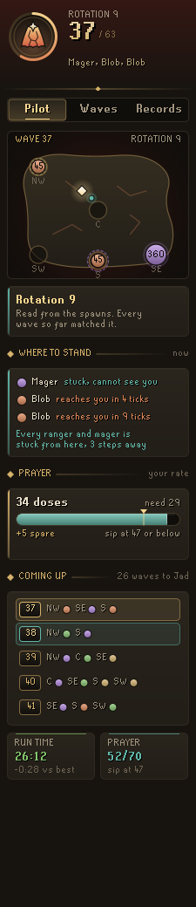
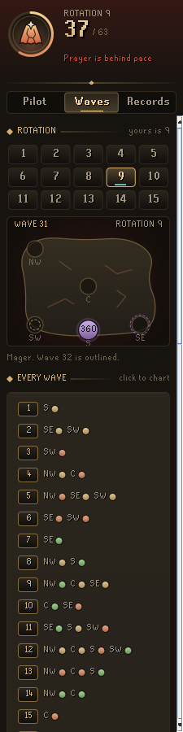
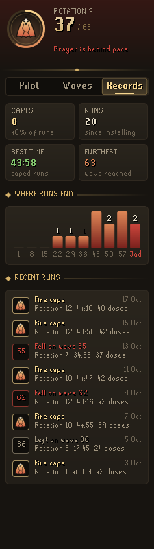
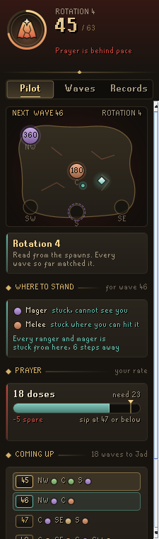
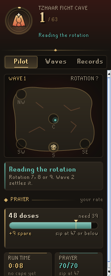
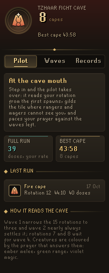
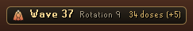

# Codex Fight Caves Pilot

**Your Fight Cave rotation from the first spawns, where to stand every wave, and prayer paced against the waves left.** Walk in and fight as normal: the pilot watches where the first creatures appear and works out which of the cave's 15 rotations you are on, with no buttons to press. From then on it gilds the tile where rangers and magers get stuck behind a pillar, outlines where the next wave will appear as the current one ends, and keeps your prayer doses measured against what the rest of the run will take.

It is part of the **Codex** suite, alongside [Codex Navigator](https://github.com/Nubles/OSRS-Codex-Navigator), [Codex Guardian](https://github.com/Nubles/OSRS-Codex-Guardian), [Codex Gear Roadmap](https://github.com/Nubles/OSRS-Codex-Gear-Roadmap), [Codex Session Chronicle](https://github.com/Nubles/OSRS-Codex-Session-Chronicle), [Codex Ledger](https://github.com/Nubles/OSRS-Codex-Ledger) and [Codex Quartermaster](https://github.com/Nubles/OSRS-Codex-Quartermaster), and shares their look: warm ink, aged gold and the game's own fonts.

<p align="center">
  
  
  
</p>

## What it does

- **Rotation, read for you.** Wave 1 narrows the 15 rotations to three and wave 2 almost always settles it; rotations 7 and 8 look the same until wave 4, and the panel says so. No clicking spawn buttons or pressing "next" every wave. Rejoin a run after logging out and it picks up where it was.
- **Where to stand.** Creatures in the cave walk straight at you with no path finding, which is why pillars work. The pilot plays that walk out for every creature and every tile you could reach, using the cave's real collision and line of sight, and gilds the tile where the fewest can hit you: rangers and magers stuck out of sight, melee creatures stuck where you can still shoot them, and the rest arriving one at a time rather than together. The panel lists what each creature will do if you stand there ("Mager: stuck, cannot see you", "Melee: reaches you in 6 ticks").
- **Follow the fight.** During a wave the tile is re-worked from where the creatures really are, and only moves when a new tile is clearly safer, so it does not flicker.
- **The next wave.** As a wave draws to a close, dashed outlines on the floor show where the next wave's creatures will appear, coloured by the prayer that answers them, and a teal tile shows where to be standing when they do.
- **Stuck tags.** A small "Stuck" tag floats over any ranger or mager that cannot hit you where you stand.
- **Prayer pacing.** The cave's waves follow a fixed ladder, so what is left of a run is known exactly. The pilot learns how much prayer you spend per hitpoint of wave on the waves that need protection prayers, and turns that into doses: how many you carry, how many the rest of the run takes, how many you have spare, and the level to sip at so no dose overflows. Doses for Jad are held back (four by default). If you fall behind, a line in the chat box says by how much.
- **Waves.** Every wave of every rotation, to study before you go in: pick a rotation, click any wave to see it on the cave chart with the wave after it outlined.
- **Records.** Capes, runs, best time and furthest wave, where your runs end in stretches of seven waves, and recent runs with rotation, time and doses drunk. While a run is on, the panel shows how you stand against your best cape at the same wave.
- **Plaque.** A slim plaque in the game view with the wave, the rotation and your doses against pace.

<p align="center">
  
  
  
</p>
<p align="center">
  
</p>

## How it reads the cave

The cave's spawn points (north-west, centre, south-west, south and south-east) start as estimates from the cave's outline. Each wave read cleanly against a known rotation pins its spawn points to the tiles creatures really used, and records which creature stood where, so the pilot gets more exact the more you play. A rotation is never ruled out for good: one misread spawn cannot leave it without an answer, and the panel says when a wave disagreed.

The wave ladder (which creatures each wave holds) is worked out from the cave's own rule rather than typed in. The rotation table lists the spawn points for every wave of every rotation as players number them.

## Rules posture

Codex Fight Caves Pilot only reads what the game already shows you: where creatures appear, the cave's collision map, your prayer and your inventory. It does not click, change menus, or send anything over the network.

It gives no help with TzTok-Jad's attacks. RuneLite removed its Jad helper because it took the challenge out of the fight, so on wave 63 the pilot steps back: no tile, no prayer cues, just "watch him, not the panel". Everything it does offer, from wave spawn charts to safespot tiles, is the same kind of help the community's rotation guides and RuneLite's own Inferno plugin give.

## Development

```bash
./gradlew build   # compile and run tests
./gradlew run     # launch RuneLite with the plugin loaded
```

The rotation tracker, wave ladder, collision and line of sight rules, stand planner and prayer pacer (`core/`) are plain Java with unit tests; the panel and overlays are in `ui/` and `overlay/`. The step and line of sight rules are ported from RuneLite's `WorldArea`.

## Licence

BSD 2-Clause, see [LICENSE](LICENSE).
