# Codex Fight Caves Pilot

**Your Fight Cave rotation read from the first spawns, every wave raced against your best run's ghost, and a report on where a run lost its time and its supplies.** Walk in and fight as normal: there are no buttons to press, and nothing tells you how to fight. The pilot works out which of the cave's 15 rotations you are on, times every wave against the same wave of your personal best, counts the prayer doses and food each wave took, and after the run names the waves that cost you most. On the Jad wave it steps back completely.

It is part of the **Codex** suite of RuneLite plugins and shares their look: warm ink, aged gold and the game's own fonts.

<p align="center">
  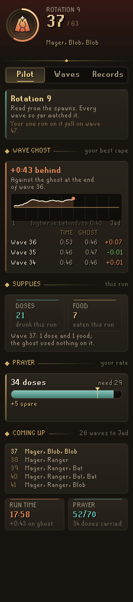
  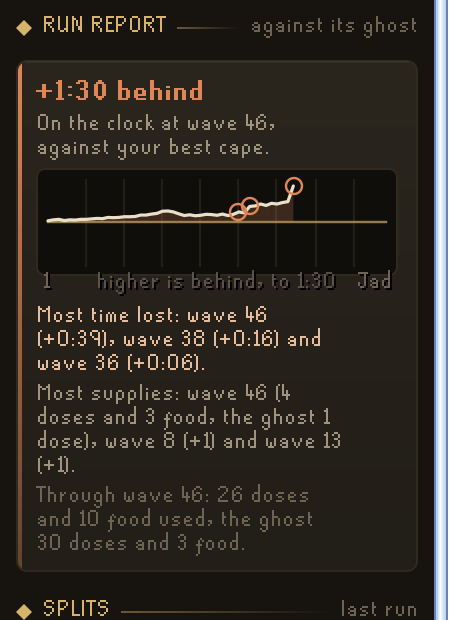
  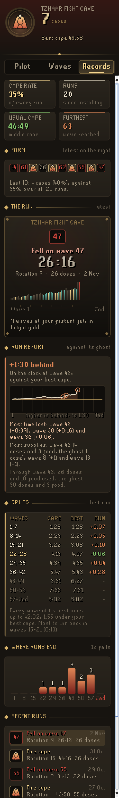
</p>

## In the cave

- **Rotation, read for you.** Wave 1 narrows the 15 rotations to three and wave 2 almost always settles it. Rotations 7 and 8 look the same until wave 4, and the panel says so. Log out mid-run and it picks up where it was when you log back in.
- **Wave ghost.** Your best run rides along as a ghost: your fastest cape timed from wave 1, or before your first cape, your furthest run. At the end of every wave the panel says how far ahead or behind it you are ("+0:43 behind, against the ghost at the end of wave 36"), draws the whole run so far as a line about the ghost's, ember where you are behind and green where you are ahead, and sets your last three waves against the same waves of the ghost.
- **Supplies per wave.** Every dose of prayer potion, super restore or sanfew drunk and every piece of food eaten is filed against the wave it was used on. The panel shows the run's totals and this wave's beside what the ghost used on it.
- **Prayer pacing.** The waves follow a fixed ladder, so what is left of a run is known exactly. The pilot learns how much prayer you spend per hitpoint of wave and turns it into doses: what you carry, what the rest of the run takes and how many are spare. Doses for Jad are held back (four by default).
- **Coming up.** What the next few waves hold ("Mager, Ranger, Bat"), as any rotation table lists it.
- **Plaque.** A slim plaque in the game view with the wave, the rotation, your doses against pace and the run against its ghost ("Ghost +0:43").

These are a clock and a tally. The pilot gives no in-fight cues of any kind: no tile to stand on, no prayer to use, no kill order, no attack timing and no eat warning.

<p align="center">
  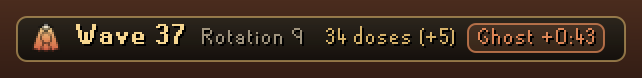
</p>

## The rotation clock

The cave gives you a rotation by the time you walk in: it changes every minute, and rotation 4 lasts two (OSRS wiki, *TzHaar Fight Cave/Rotations*). The pilot reads the game's own clock, so you know your rotation before you go in.

- **At the cave mouth.** Stand anywhere in Mor Ul Rek and a small plaque says which rotation you would get if you walked in now, the next one and when it comes on, with a hairline burning down the minute. In its last seconds it says the rotation is changing, as either side may be the one you get.
- **Your rotations, your times.** The panel shows the 16-minute cycle as a dial, your fastest and steadiest rotations (from your own runs) and how long until each comes up, and the next five rotations with your best time on each.
- **It checks itself.** Every run, what the clock said as you went in is checked against what the spawns then show, and kept per account. After three right in a row, the pilot names your rotation the moment you walk in, so the Waves page and the plaque have it from wave 1. Two misses in five and it says so plainly and goes back to reading the spawns.
- **The spawns always win.** A clock call never overrules what the spawns show: the first wave that disagrees drops it, and the miss is counted. Walking in on the turn of a minute keeps both rotations either side, and wave 1 always tells those two apart.

<p align="center">
  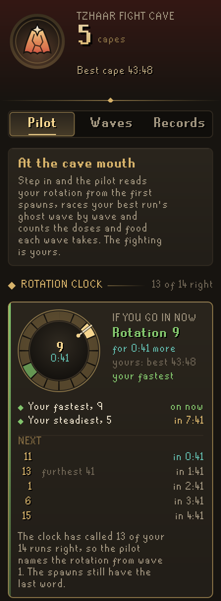
  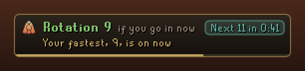
</p>

The order of the rotations through the cycle is the one the Fight Caves Spawn Predictor plugin by Damen uses (github.com/damencs/spawn-predictor); its rotation numbers were checked against this plugin's own rotation table, every wave of every rotation.

## Before you go in

- **Waves.** Every wave of every rotation to study: pick a rotation, click any wave to see where it spawns on the cave chart with the wave after it outlined.
- **Ready check.** Whether your Prayer level gives all three protection prayers, how far your weapon reaches, whether a bow or crossbow has ammunition, how much food you carry and whether you carry prayer potions.
- **Supply check.** The doses you carry against a whole run at your rate, Jad's share included: enough, how many spare, or how many more to bring.
- **Runs in the bank.** How many whole runs the prayer potions, super restores and sanfew serums in your bank cover, from your last look at the bank (or Codex Bank Steward's snapshot when that is newer).
- **Your pace to Jad.** Your usual time for each wave adds up to when a run reaches Jad, once every wave has been cleared at least twice.

<p align="center">
  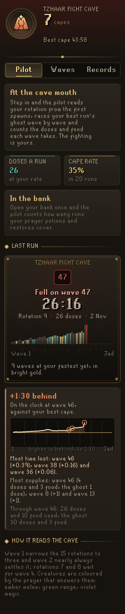
  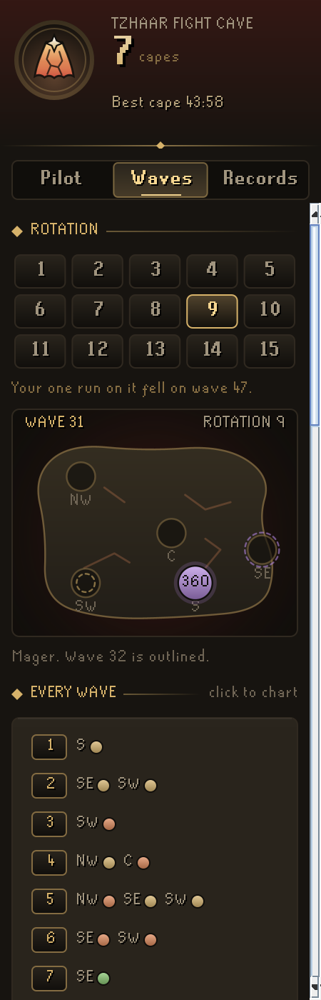
  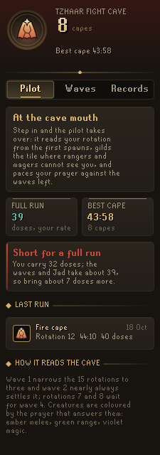
</p>

## After a run

- **Run report.** Every run is set against its ghost (your best run other than it): how far ahead or behind it finished on the clock, the run drawn as a line about the ghost's with the costliest waves ringed, the three waves that lost the most time ("Most time lost: wave 46 (+0:39), wave 38 (+0:16) and wave 36 (+0:06)"), the waves that took the most supplies past the ghost's, and the doses and food both used over the waves both cleared. The wave a run fell on was never finished, so it is not weighed. The report sits under the last run at the cave mouth and under any run picked on the Records page.
- **Run scroll.** Every finished run is kept as a scroll: which fire cape it was or the wave it fell on, its time, and the whole run as a skyline of 63 waves, gold where a wave was your fastest yet, with the damage each wave cost hanging below. A line or two says what made the run.
- **Why a run fell.** When a run ends before Jad, its last ten seconds are read for the likeliest cause (prayer ran out, two styles at once, the wrong prayer, no prayer, or worn down) and said in a sentence beside your hitpoints falling. A fall to Jad is not reviewed.
- **Records.** Your cape rate, runs, usual cape time and furthest wave; your form over the last ten runs; how your runs on each rotation have gone; where your runs end and where they hurt, in stretches of seven waves; and every run's splits against your best cape, with the time your best waves add up to.

<p align="center">
  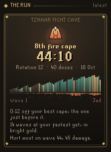
  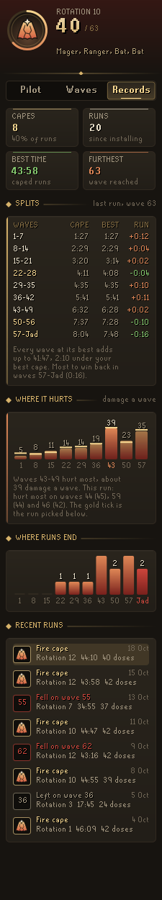
</p>

## Settings that matter

Settings come in a few groups. Every option except field notes is on by default.

- **During a run:** *Pilot plaque* and *Wave ghost on the plaque*. Neither shows on the Jad wave.
- **Planning and chat:** *Doses kept for Jad* (how many prayer doses pacing holds back for him, 4 by default) and *Notes in chat* (rotation known, prayer behind pace, why a run ended).
- **Rotation clock:** *Rotation clock* turns the whole clock off: the plaque at the cave mouth, the panel's dial and naming the rotation before the spawns. The plaque also follows *Pilot plaque*.

## Works with other Codex plugins

- **[Codex Bank Steward](https://github.com/Nubles/OSRS-Codex-Bank-Steward):** reads its shared bank snapshot (`bankV1`) to count your prayer doses before you have opened the bank with the pilot on. Read only, never written. Without Bank Steward the pilot counts the bank itself the next time you open it.

Nothing else is needed: every feature works with only this plugin installed.

## Your data

Your runs (with each wave's time, damage, doses and food), prayer rate and learned spawn tiles are saved in your RuneLite profile, per account, like any other RuneLite setting. The pilot keeps your last 60 runs and always your best cape. A damaged or hand-edited save is mended when it is read: anything that cannot be read is left out a field or a run at a time, so the rest of your records survive. When a save holds anything this version cannot keep (it was damaged, or written by a newer version of the pilot), a copy of it as found is put aside under `logbookBackup` before it is first written over.

## Rules posture

Codex Fight Caves Pilot only reads what the game already shows you: where creatures appear, your prayer, your equipment and your inventory. It does not click, change menus, or send anything over the network.

It gives no in-fight cues for any creature: no tile to stand on, no prayer to use, no kill order, no attack timing, no eat warning, and nothing drawn on the cave floor. What it shows during a run is a clock against your own best, a tally of your supplies and the wave list any rotation guide gives. On wave 63 it steps back entirely: no plaque, no ghost, no prayer pacing, no splits and no chat lines. Every page of the panel shows one card saying it has stepped back. When a run ends in a fall before Jad, its last ten seconds are read for the likeliest cause and said once the run is over; nothing from that is shown during a wave.

## How it reads the cave

The cave's five spawn points start on their known tiles, so the first wave is placed exactly. Each wave read cleanly nudges its spawn points to the tiles creatures really used, per size of creature, so a spawn the game moves by a tile still lines up. A rotation is never ruled out for good, so one misread spawn cannot leave it without an answer.

A single odd tick never ends a run: you only count as having left after two ticks outside in a row. A run the pilot did not see from wave 1 is still followed and filed, but its time is not a record. Logging back in mid-run restarts that wave's clock, as the game does. Closing the client saves the logbook first.

## Field notes

An optional setting, **Keep field notes** (under Field notes, off by default), writes a plain record of what Fight Caves Pilot reads and decides to its own folder in `.runelite/plugin-data` on your computer, one line at a time. It is for checking the plugin's guesses against real play: when something looks wrong, the notes show what it saw and why it chose what it did. Other players' chat is never written down, it stays on your computer, and nothing is sent anywhere.

## Development

```bash
./gradlew build   # compile and run tests
./gradlew run     # launch RuneLite with the plugin loaded
```

The rotation tracker, wave ladder, wave ghost and run report, splits, fall review, weapon reach and prayer pacer (`core/`) are plain Java with unit tests; the panel and plaque are in `ui/` and `overlay/`. Replay scripts under `src/test/resources/replays` play whole runs against the plugin, the wave ghost included. The step and line of sight rules the fall review uses are ported from RuneLite's `WorldArea`.

## Licence

BSD 2-Clause, see [LICENSE](LICENSE).
