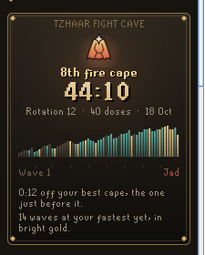

# Codex Fight Caves Pilot

**Your Fight Cave rotation read from the first spawns, where to stand every wave, and your prayer paced against the waves left.** Walk in and fight as normal: there are no buttons to press. The pilot works out which of the cave's 15 rotations you are on, gilds the tile where rangers and magers get stuck behind a pillar, and keeps your prayer doses measured against what the rest of the run will take. On the Jad wave it steps back completely.

It is part of the **Codex** suite of RuneLite plugins and shares their look: warm ink, aged gold and the game's own fonts.

<p align="center">
  
  
  
</p>

## In the cave

- **Rotation, read for you.** Wave 1 narrows the 15 rotations to three and wave 2 almost always settles it. Rotations 7 and 8 look the same until wave 4, and the panel says so. Log out mid-run and it picks up where it was when you log back in.
- **Where to stand.** Cave creatures walk straight at you with no path finding, which is why pillars work. The pilot plays that walk out for every creature and every tile you could reach, using the cave's real collision and line of sight, and gilds the tile where the fewest can hit you. It avoids tiles where two attack styles reach you at once, where a ranger or mager ends up beside you and switches to melee, and where a Tz-Kek would split on top of you. The panel lists what each creature will do if you stand there ("Mager: stuck, cannot see you").
- **Your weapon's reach.** It reads what you wield, so a blowpipe, a crossbow, a longbow and a staff each get the tiles they can really hit a stuck creature from.
- **Kill order.** A numbered seal over each creature: whatever hits you hardest for the health it takes to kill comes first, then creatures stuck where you can hit them. Your protection prayer counts, bats come early because they drain prayer through it, and a Yt-MejKot jumps the queue once something it can heal is hurt.
- **The prayer to use.** The protection prayer that blocks the most of what can hit you from where you stand, with a nudge when it is not on. When two styles hit you at once it says so, since no prayer covers both.
- **Eat warning.** When what can land on you in the next couple of ticks, past the prayer you have up, adds up to your hitpoints, the plaque shows "Eat: 26 can land".
- **The next wave, rehearsed.** As a wave draws to a close, outlines on the floor show where the next wave appears and a teal tile shows where to be. The panel plays that wave out on a true map of the cave, each creature walking to where it will stop, under a line such as "First hit on tick 6 (3.6s), from the melee. 1 of 2 stick."
- **Why that tile.** When the gilt tile is clearly safer than where you are, the panel sets the two side by side, creature by creature, with one sentence on what changes.
- **Prayer pacing.** The waves follow a fixed ladder, so what is left of a run is known exactly. The pilot learns how much prayer you spend per hitpoint of wave and turns it into doses: what you carry, what the rest of the run takes, how many are spare and the level to sip at. Doses for Jad are held back (four by default).
- **Splits.** The run clock against your best cape at the same wave, and your last three waves against the same waves of that cape.
- **Plaque.** A slim plaque in the game view with the wave, the rotation, your doses against pace and the prayer to use.

<p align="center">
  
  
  
</p>

## Before you go in

- **Waves.** Every wave of every rotation to study: pick a rotation, click any wave to see it on the cave chart with the wave after it outlined.
- **Road to Jad.** Once you have fought a rotation, each of its waves is rated on a tablet of 63 stones: teal where every ranger and mager sticks behind a pillar, gold where one prayer covers what reaches you, ember where two styles reach you from every tile. A line names the next hard wave and why.
- **Ready check.** Whether your Prayer level gives all three protection prayers, how far your weapon reaches, whether a bow or crossbow has ammunition, how much food you carry and whether you carry prayer potions.
- **Supply check.** The doses you carry against a whole run at your rate, Jad's share included: enough, how many spare, or how many more to bring.
- **Runs in the bank.** How many whole runs the prayer potions, super restores and sanfew serums in your bank cover, from your last look at the bank (or Codex Bank Steward's snapshot when that is newer).
- **Your pace to Jad.** Your usual time for each wave adds up to when a run reaches Jad, once every wave has been cleared at least twice.

<p align="center">
  
  
  
</p>

## After a run

- **Run scroll.** Every finished run is kept as a scroll: which fire cape it was or the wave it fell on, its time, and the whole run as a skyline of 63 waves, gold where a wave was your fastest yet, with the damage each wave cost hanging below. A line or two says what made the run.
- **Why a run fell.** When a run ends before Jad, its last ten seconds are read for the likeliest cause (prayer ran out, two styles at once, the wrong prayer, no prayer, or worn down) and said in a sentence beside your hitpoints falling. A fall to Jad is not reviewed.
- **Records.** Your cape rate, runs, usual cape time and furthest wave; your form over the last ten runs; how your runs on each rotation have gone; where your runs end and where they hurt, in stretches of seven waves; and every run's splits against your best cape, with the time your best waves add up to.

<p align="center">
  
  
</p>

## Settings that matter

Settings come in three groups. Every option is on by default.

- **Where to stand:** *Mark where to stand* (the gilt tile), *Follow the fight* (re-work the tile from where creatures really are), *Show the next wave* and *Rehearse the next wave*.
- **During a wave:** *Tag stuck creatures*, *Kill order*, *Prayer to use*, *Eat warning* and *Pilot plaque*. None of these shows on the Jad wave.
- **Planning and chat:** *Doses kept for Jad* (how many prayer doses pacing holds back for him, 4 by default), *Road to Jad* and *Notes in chat* (rotation known, prayer behind pace, why a run ended).

## Works with other Codex plugins

- **[Codex Bank Steward](https://github.com/Nubles/OSRS-Codex-Bank-Steward):** reads its shared bank snapshot (`bankV1`) to count your prayer doses before you have opened the bank with the pilot on. Read only, never written. Without Bank Steward the pilot counts the bank itself the next time you open it.

Nothing else is needed: every feature works with only this plugin installed.

## Your data

Your runs, prayer rate, learned spawn tiles and road ratings are saved in your RuneLite profile, per account, and stay on your computer. The pilot keeps your last 60 runs and always your best cape. A damaged or hand-edited save is mended when it is read: anything that cannot be read is left out a field or a run at a time, so the rest of your records survive.

## Rules posture

Codex Fight Caves Pilot only reads what the game already shows you: where creatures appear, the cave's collision map, your prayer, your equipment and your inventory. It does not click, change menus, or send anything over the network.

It gives no help with TzTok-Jad's attacks. RuneLite removed its Jad helper because it took the challenge out of the fight, so on wave 63 the pilot steps back entirely: no plaque, no tile, no prayer to use, no prayer pacing, no eat warning, no kill order, no stuck tags, no splits and no chat lines, and no outline or rehearsal of his wave as wave 62 ends. Every page of the panel shows one card saying it has stepped back. Everything it does offer, from wave charts to safespot tiles, is the kind of help the community's rotation guides and RuneLite's own Inferno plugin give.

## How it reads the cave

The cave's five spawn points start on their known tiles, so the first wave is placed exactly. Each wave read cleanly nudges its spawn points to the tiles creatures really used, per size of creature, so a spawn the game moves by a tile still lines up. A rotation is never ruled out for good, so one misread spawn cannot leave it without an answer.

A single odd tick never ends a run: you only count as having left after two ticks outside in a row. A run the pilot did not see from wave 1 is still followed and filed, but its time is not a record. Logging back in mid-run restarts that wave's clock, as the game does. Closing the client saves the logbook first.

## Development

```bash
./gradlew build   # compile and run tests
./gradlew run     # launch RuneLite with the plugin loaded
```

The rotation tracker, wave ladder, collision and line of sight rules, stand planner, rehearsal, road to Jad, splits, kill order, prayer call, weapon reach and prayer pacer (`core/`) are plain Java with unit tests; the panel and overlays are in `ui/` and `overlay/`. The step and line of sight rules are ported from RuneLite's `WorldArea`.

## Licence

BSD 2-Clause, see [LICENSE](LICENSE).
