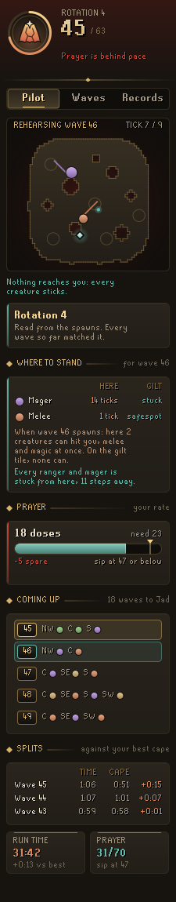
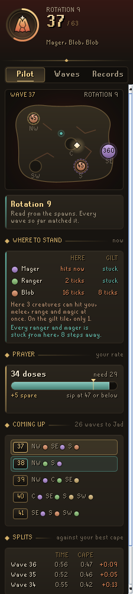
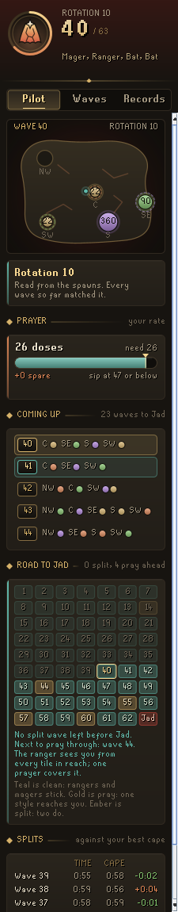
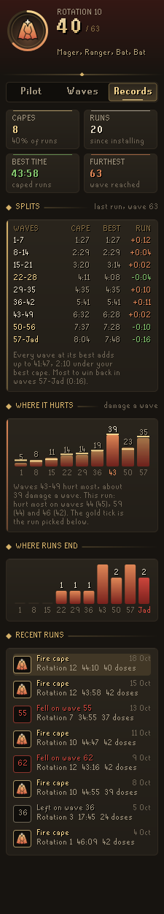
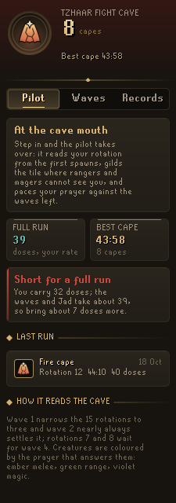

# Codex Fight Caves Pilot

**Your Fight Cave rotation from the first spawns, where to stand every wave, and prayer paced against the waves left.** Walk in and fight as normal: the pilot watches where the first creatures appear and works out which of the cave's 15 rotations you are on, with no buttons to press. From then on it gilds the tile where rangers and magers get stuck behind a pillar, outlines where the next wave will appear as the current one ends, and keeps your prayer doses measured against what the rest of the run will take.

It is part of the **Codex** suite, alongside [Codex Navigator](https://github.com/Nubles/OSRS-Codex-Navigator), [Codex Guardian](https://github.com/Nubles/OSRS-Codex-Guardian), [Codex Gear Roadmap](https://github.com/Nubles/OSRS-Codex-Gear-Roadmap), [Codex Session Chronicle](https://github.com/Nubles/OSRS-Codex-Session-Chronicle), [Codex Ledger](https://github.com/Nubles/OSRS-Codex-Ledger) and [Codex Quartermaster](https://github.com/Nubles/OSRS-Codex-Quartermaster), and shares their look: warm ink, aged gold and the game's own fonts.

<p align="center">
  
  
  
</p>

## What it does

- **Rotation, read for you.** Wave 1 narrows the 15 rotations to three and wave 2 almost always settles it; rotations 7 and 8 look the same until wave 4, and the panel says so. No clicking spawn buttons or pressing "next" every wave. Rejoin a run after logging out and it picks up where it was.
- **Where to stand.** Creatures in the cave walk straight at you with no path finding, which is why pillars work. The pilot plays that walk out for every creature and every tile you could reach, using the cave's real collision and line of sight, and gilds the tile where the fewest can hit you: rangers and magers stuck out of sight, melee creatures stuck where you can still shoot them, and the rest arriving one at a time rather than together. It also avoids tiles where two attack styles reach you at once, since one prayer cannot block both, tiles where a ranger or mager ends up beside you and switches to melee, and letting a Tz-Kek die on top of you, where its two halves start on you at once. The panel lists what each creature will do if you stand there ("Mager: stuck, cannot see you", "Melee: reaches you in 6 ticks").
- **Kill order.** A numbered gilt seal over each creature says what to kill first. Whatever hits you comes first, ordered by how much damage it deals for every hitpoint it takes to kill, so the weak creature hitting hard dies before the strong one hitting softly. Your protection prayer counts: what it blocks can wait. Bats come early because they drain prayer even through it, a Yt-MejKot jumps the queue once anything else is below half health because it heals them, and a Tz-Kek is weighed with the two halves it splits into. After that come creatures stuck where you can hit them, deadliest first. Nothing is shown on the Jad wave.
- **The prayer to use.** From where you stand, the pilot works out which protection prayer blocks the most of what can hit you in the next couple of ticks, and shows it on the plaque and in the panel, with a nudge when it is not on. A ranger or mager beside you counts as melee, since that is how they hit up close. When two styles are hitting you at once it says so, because no prayer covers both and the gilt tile is where to lose one. Nothing is shown on the Jad wave.
- **Your weapon's reach.** The pilot reads what you wield, so a blowpipe, a crossbow, a longbow and a staff each get the tiles they can really hit a stuck creature from.
- **Follow the fight.** During a wave the tile is re-worked from where the creatures really are, and only moves when a new tile is clearly safer, so it does not flicker.
- **The next wave.** As a wave draws to a close, dashed outlines on the floor show where the next wave's creatures will appear, coloured by the prayer that answers them, and a teal tile shows where to be standing when they do.
- **Wave rehearsal.** As a wave draws to a close, the pilot plays the next one out before it spawns. On the floor, a dotted trail runs from each spawn point to where that creature will stop, ending in a teal ring where it sticks or an ember one where it reaches you, with how many ticks it takes. On the panel the same wave plays at the game's pace on a true map of the cave, its floor and pillars read from the game's own collision map, looping with a pause on how it ends, under one line such as "First hit on tick 6 (3.6s), from the melee. 1 of 2 stick."
- **Why that tile.** When the gilt tile is clearly safer than where you are, the panel sets the two side by side, creature by creature ("Mager: hits now" against "stuck"), with one sentence on what changes: fewer creatures able to hit you, one prayer covering what is left instead of two styles at once, or the first hit landing later. It works for the fight on now and for where to be when the next wave spawns.
- **Road to Jad.** Once the rotation is known, every wave left is planned the way the pilot plans the next one, from the tile the wave before leaves you on, and rated on a tablet of 63 stones: teal where every ranger and mager sticks behind a pillar, gold where one style reaches you wherever you stand (one prayer covers it), ember where two styles reach you at once and one prayer cannot block both. A line names the next hard wave, how many waves away it is and which creatures make it hard. The ratings are saved, so the Waves page shows them for any rotation you have fought, and its stones can be clicked to chart a wave.
- **Stuck tags.** A small "Stuck" tag floats over any ranger or mager that cannot hit you where you stand.
- **Prayer pacing.** The cave's waves follow a fixed ladder, so what is left of a run is known exactly. The pilot learns how much prayer you spend per hitpoint of wave on the waves that need protection prayers, and turns that into doses: how many you carry, how many the rest of the run takes, how many you have spare, and the level to sip at so no dose overflows. Doses for Jad are held back (four by default). If you fall behind, a line in the chat box says by how much.
- **Waves.** Every wave of every rotation, to study before you go in: pick a rotation, click any wave to see it on the cave chart with the wave after it outlined.
- **Where it hurts.** Every hit you take is filed under the wave it landed on. Records shows the damage you take on an average wave in each stretch of seven, with the stretch that hurts most lit, a gold tick for the run you picked, and that run's worst waves ("Hurt most on waves 46 (45), 59 (44) and 53 (42). Wave 59 took 44 before the fall.").
- **Supply check.** At the cave mouth the pilot sets the doses you carry against what a whole run takes at your rate, Jad's share included, and says whether that is enough, how many are spare, or how many more to bring.
- **Records.** Capes, runs, best time and furthest wave, where your runs end in stretches of seven waves, and recent runs with rotation, time and doses drunk.
- **Splits.** Every run is timed wave by wave and read the way speedrunners read a run. Records cuts it into nine stretches of seven waves, with your best cape's time, your best ever for that stretch (gilt when the run matched it) and how the run did against the cape, green when ahead. Click any recent run to set its splits against the cape instead of the latest. Adding up your best of every wave gives the time you have already proven you can do, and the panel says how far under your best cape that is and which stretch holds the most to win back. During a run, the last three waves sit against the same waves of your best cape, and the run clock against the cape at the same wave.
- **Plaque.** A slim plaque in the game view with the wave, the rotation and your doses against pace.

<p align="center">
  
  
  
</p>
<p align="center">
  
  
  
</p>
<p align="center">
  
  
</p>
<p align="center">
  
</p>

## How it reads the cave

The cave's five spawn points (north-west, centre, south-west, south and south-east) start on their known tiles, so the very first wave is placed exactly. Each wave read cleanly against a known rotation nudges its spawn points to the tiles creatures really used, and records which creature stood where, so a spawn the game ever moves by a tile or two still lines up. A rotation is never ruled out for good: one misread spawn cannot leave it without an answer, and the panel says when a wave disagreed.

Spawn tiles are also learned per size of creature, since a mager's five-tile body may not sit on the same corner tile as a bat's at the same spawn point.

A run the pilot did not see from wave 1 (turned on part way, or carried over from another computer) is still followed and filed, but its time is not counted as a record and its earlier waves are left untimed, so splits always line up with their waves. Logging back in mid-run restarts that wave's clock, as the game restarts the wave. Killing Jad moves you out of the cave, so the pilot waits a few ticks for the kill count before calling it a walk-out.

The wave ladder (which creatures each wave holds) is worked out from the cave's own rule rather than typed in. The rotation table lists the spawn points for every wave of every rotation as players number them.

## Rules posture

Codex Fight Caves Pilot only reads what the game already shows you: where creatures appear, the cave's collision map, your prayer and your inventory. It does not click, change menus, or send anything over the network.

It gives no help with TzTok-Jad's attacks. RuneLite removed its Jad helper because it took the challenge out of the fight, so on wave 63 the pilot steps back: no tile, no prayer to use, no kill order, just "watch him, not the panel". Everything it does offer, from wave spawn charts to safespot tiles, is the same kind of help the community's rotation guides and RuneLite's own Inferno plugin give.

## Development

```bash
./gradlew build   # compile and run tests
./gradlew run     # launch RuneLite with the plugin loaded
```

The rotation tracker, wave ladder, collision and line of sight rules, stand planner, wave rehearsal, road to Jad, damage log, tile comparison, splits, kill order, prayer call, weapon reach and prayer pacer (`core/`) are plain Java with unit tests; the panel and overlays are in `ui/` and `overlay/`. The step and line of sight rules are ported from RuneLite's `WorldArea`.

## Licence

BSD 2-Clause, see [LICENSE](LICENSE).
